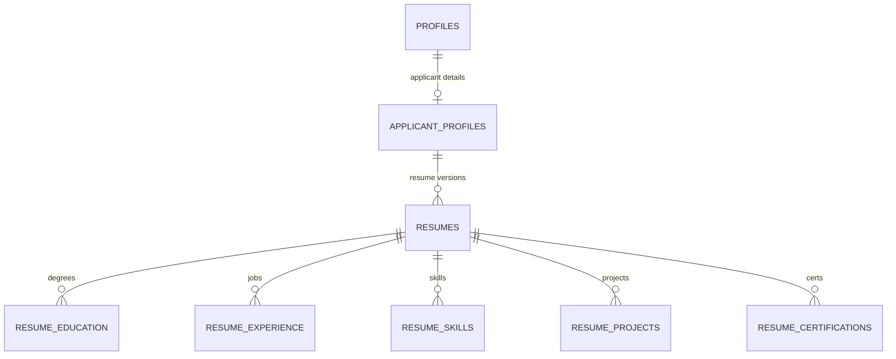

# Resume — Schema Design

Defines the `resumes` table and its structured content tables. KAN-50
explicitly deferred resume work (line 257: "Leave resume storage and parsing
to Brian's separate work"), so this doc owns the full resume domain.

## The experience bank replaces the content tables (KAN-206)

The `resume_*` content tables below were never built; an uploaded resume
keeps its parser output in `resumes.parsed_json`. Resume facts now live in
the **experience bank** (terms: `GLOSSARY.md`), stored once per student and
not per resume, so a built resume is a live view of it (ADR 0001):

```
applicant_profiles
  ├── experience_banks   one row per student: the bank embedding and when it was made
  ├── bank_entries       one per job, degree, project, club role, award or certification
  │     └── bank_bullets the entry's lines, in order, in their original wording
  └── bank_skills        a plain list, each with an optional group
        └── bank_skill_links  the entries that show the skill (none is fine)
```

- **Six entry sections, not seven.** Skills is the seventh section, but a
  skill is its own row (`bank_skills`), so the `bank_section` enum has six
  values.
- **One entry shape for every section.** Title (required), organization,
  location, start month, and an end that is a month, Present or expected.
  The few fields one section needs are columns on the same row and stay null
  elsewhere: Education's degree, field of study, GPA and scale, coursework
  and honors; Projects' link; Certifications' issuer; Awards' one date.
  `backend/app/schemas/bank.py` decides which section owns which field.
- **Months are dates on the first of the month**, sent as `YYYY-MM`: a
  resume shows a month, never a day.
- **The embedding moves to the bank row.** A null embedding means "remake it
  on the next recommendations request", so every change to an entry, bullet
  or skill sets it back to null. The recommender and Scout read the bank
  (KAN-212); `resumes.embedding` is no longer mapped and is dropped once that
  code is deployed (expand, then contract).
- **The duplicate check matches section, title and organization, ignoring
  case.** It warns and never blocks: two real roles may share a title.
- **A skill links to the entries that show it** (KAN-216), so Tailor can
  show the skill with proof. A skill with no links is fine: one learned on
  one's own. Links do not clear the embedding, whose text never pairs a
  skill with an entry.
- Bullet variants are a later table that points at these. The rules live
  in `backend/app/services/bank.py`.

### Import fills the bank from an upload (KAN-211)

An uploaded resume reaches the bank only through **import**: the heuristic
parser reads the upload's stored text again, and the API returns draft
entries that the student checks and saves one by one or with "Save all".
Import writes nothing itself. A draft that matches a bank entry (the
duplicate check) shows "Already in your bank" and "Save all" skips it. The
parser reads all seven sections, Leadership & Activities and Awards
included. The profile page's parsed-JSON editor is gone, so the bank is the
only place to edit resume facts; `resumes.parsed_json` is now the parser's
own output, never edited, and stays only until the recommender and Scout
read the bank.

**Model parsing** (KAN-222): when the parser finds no entries, the API reads
the upload with AI instead, and "Read It Again with AI" on the drafts asks
for that reading on purpose. The model gets the text with identity data
removed, and each entry it returns is checked against the entry schema. It
costs one AI reading a day (the parsing cap), counted only when it works.

## Built resumes (KAN-207)

A built resume is a choice over the bank, never a copy of it (ADR 0001):

```
applicant_profiles
  └── built_resumes            name, template id, optional job posting
        ├── built_resume_entries   entry: shown, position in its section, GPA and coursework toggles
        ├── built_resume_bullets   bullet: shown, position in its entry
        └── built_resume_skills    skill: shown, position
```

- **No text on a built resume.** The view (`backend/app/services/resume_view.py`)
  joins the choices to the bank's current text, so a fix in the bank shows
  everywhere. The chosen bullet variant joins `built_resume_bullets` when
  variants exist (Tailor, the editor).
- **No choice row, not on the resume.** Generate writes a row for everything
  in the bank at that moment; what is added later waits in the editor's tray
  instead of appearing on old resumes. Bullets and skills follow the same
  rule as entries, so a bullet added to an entry already on a resume waits
  too.
- **Base or tailored by `job_posting_id`.** Null is a base resume. A posting
  has at most one tailored resume per student (a unique key; NULLs distinct).
  Deleting the posting deletes its tailored resume; sent resumes keep their
  own file.
- **The limit is 5 uploaded plus base resumes.** Tailored and sent resumes
  do not count. The API checks before writing, on Generate and on upload.
- **The default resume is one of two pointers.** It was
  `applicant_profiles.default_resume_id`, a foreign key to `resumes`, and it
  can now be a base resume too. A single id column could not keep a foreign
  key to two tables, and a type column with no foreign key would leave a
  dangling id when a resume is deleted. So a second nullable column,
  `default_built_resume_id` → `built_resumes.id`, sits beside it, both
  `ON DELETE SET NULL`, with a check that at most one is set. Setting one
  clears the other. Deleting the default leaves no default, as before.
- **The template id is stored, not the template.** `jakes` is the only one;
  a second template is its own slice. The Word file is one plain layout with
  no id.

## Sent resumes (KAN-208)

A sent resume is the exact file a student downloaded or applied with, kept
unchanged. Built resumes are live views, so without it there would be no
record of what an employer actually received.

```
applicant_profiles
  └── sent_resumes   storage path, name then, time, optional job posting, content hash
        ├─ built_resume_id     → built_resumes  (ON DELETE SET NULL)
        └─ uploaded_resume_id  → resumes        (ON DELETE SET NULL)
```

- **The file is stored, not re-rendered.** A PDF download renders once and
  puts the PDF in the `Resume` bucket at `{applicant}/sent/{id}.pdf`. A bank
  fix, a template change or a renderer upgrade never changes it.
- **Repeats merge by a hash taken before rendering**: the view, the template
  id and the header's identity text (sha256). The same hash for the same
  built resume (and the same job posting, null for a download) returns the
  last sent resume, with no render and no upload, so the Sent list stays
  short. The name is not in the hash: it is not printed on the page.
- **The sources are a record, not an owner.** Deleting the built or uploaded
  resume nulls the link and keeps the sent resume, with the name it had.
  At most one source is set (`sent_resumes_one_source`).
- **An uploaded resume's file can outlive it.** Applying with an uploaded
  resume (KAN-220) writes a row that points at that resume's own file, with
  no hash. Deleting the uploaded resume keeps the file while a sent resume
  uses it; deleting the last such sent resume removes it.
- **Only the PDF is kept.** The Word download is not a sent resume yet.

The rest of this file is the original design for uploaded resumes.

## Relationship to KAN-50 tables

```
profiles              (KAN-50)  — auth identity
  └── applicant_profiles (KAN-50)  — stable contact info, links
        └── resumes                — file metadata, raw_text, parsed_json blob
              └── resume_education        — schools, degrees
              └── resume_experience       — jobs held
              └── resume_skills           — skill tags
              └── resume_projects         — personal/academic projects
              └── resume_certifications   — certs and licenses
```

`resumes` hangs off `applicant_profiles`, not `profiles`, so the DB enforces
that only applicants can own resumes. The applicant profile must exist before
the first upload — correct onboarding order (contact info first, then resume).

## Upload → parse → verify flow

1. User uploads a file (PDF, DOCX, etc.) → stored at `resumes.storage_path`.
2. Parser extracts text → `resumes.raw_text`, structured output → `resumes.parsed_json`, status → `parsed`.
3. (Superseded: the content tables were never built. Import turns the
   upload into bank drafts the student reviews; see above.)

## Re-upload behavior

Each upload creates a **new `resumes` row**. Old resumes and their content
tables are kept. The applicant's active ("primary") resume is
`applicant_profiles.default_resume_id`, a nullable FK with `ON DELETE SET
NULL` — one per applicant by construction, cleared when that resume is
deleted. The `resumes.is_default` column and partial unique index sketched
below were never built; the pointer replaced them. The applicant can switch
their default (`PUT /applicants/{id}/resumes/{resume_id}/default`) or delete
old versions.

## Authorization

SQLAlchemy connects as a privileged role, so Postgres RLS policies do not
fire. Authorization lives in FastAPI — endpoints verify that the authenticated
user owns the `applicant_profiles` row before allowing resume operations.
No RLS policies are defined for these tables.

## Diagram



## Enums

```sql
CREATE TYPE resume_status AS ENUM ('uploaded', 'parsed', 'parse_failed');
```

## Tables

### resumes

One row per uploaded resume file or pasted resume snapshot.

| Column | Type | Notes |
| --- | --- | --- |
| `id` | `uuid` | PK, default `gen_random_uuid()`. |
| `applicant_id` | `uuid` | FK → `applicant_profiles.profile_id`, `ON DELETE CASCADE`. |
| `original_filename` | `text` | Optional for pasted text. |
| `storage_path` | `text` | Supabase Storage path for uploaded files. Optional. |
| `file_hash` | `text` | SHA-256 hash of the uploaded file. Optional. |
| `status` | `resume_status` | Default `uploaded`. |
| `raw_text` | `text` | Extracted or pasted resume text. |
| `parsed_json` | `jsonb` | Raw parser output — not user-verified. |
| `is_default` | `boolean` | Default false. One default per applicant. |
| `created_at` | `timestamptz` | Default now. |
| `updated_at` | `timestamptz` | Default now. |

```sql
CREATE TABLE resumes (
    id                uuid PRIMARY KEY DEFAULT gen_random_uuid(),
    applicant_id      uuid NOT NULL REFERENCES applicant_profiles (profile_id) ON DELETE CASCADE,
    original_filename text,
    storage_path      text,
    file_hash         text,
    status            resume_status NOT NULL DEFAULT 'uploaded',
    raw_text          text,
    parsed_json       jsonb,
    is_default        boolean NOT NULL DEFAULT false,
    created_at        timestamptz NOT NULL DEFAULT now(),
    updated_at        timestamptz NOT NULL DEFAULT now()
);
CREATE INDEX resumes_applicant_idx ON resumes (applicant_id);

-- Only one default resume per applicant.
CREATE UNIQUE INDEX one_default_resume_per_applicant
  ON resumes (applicant_id)
  WHERE is_default = true;

-- No duplicate files per applicant.
CREATE UNIQUE INDEX unique_file_hash_per_applicant
  ON resumes (applicant_id, file_hash)
  WHERE file_hash IS NOT NULL;
```

### resume_education

| Column | Type | Notes |
| --- | --- | --- |
| `id` | `uuid` | PK, default `gen_random_uuid()`. |
| `resume_id` | `uuid` | FK → `resumes.id`, `ON DELETE CASCADE`. |
| `institution` | `text` | Required. School name. |
| `degree` | `text` | e.g. "Bachelor of Science". Optional — some entries are coursework or bootcamps. |
| `field_of_study` | `text` | e.g. "Computer Science". Optional. |
| `gpa` | `numeric(5,2)` | Optional. Supports 4.0, 5.0, 10.0, and 100-point scales. |
| `start_date` | `date` | Optional. |
| `end_date` | `date` | Optional. NULL = ongoing. |
| `description` | `text` | Optional. Honors, relevant coursework, activities. |
| `created_at` | `timestamptz` | Default now. |
| `updated_at` | `timestamptz` | Default now. |

Ordering: by `end_date DESC NULLS FIRST` (ongoing first, then newest).

```sql
CREATE TABLE resume_education (
    id             uuid PRIMARY KEY DEFAULT gen_random_uuid(),
    resume_id      uuid NOT NULL REFERENCES resumes (id) ON DELETE CASCADE,
    institution    text NOT NULL,
    degree         text,
    field_of_study text,
    gpa            numeric(5,2),
    start_date     date,
    end_date       date,
    description    text,
    created_at     timestamptz NOT NULL DEFAULT now(),
    updated_at     timestamptz NOT NULL DEFAULT now()
);
CREATE INDEX resume_education_resume_idx ON resume_education (resume_id);
```

### resume_experience

| Column | Type | Notes |
| --- | --- | --- |
| `id` | `uuid` | PK. |
| `resume_id` | `uuid` | FK → `resumes.id`, `ON DELETE CASCADE`. |
| `company_name` | `text` | Required. |
| `title` | `text` | Required. Job title held. |
| `location` | `text` | Optional. City/state or "Remote". |
| `start_date` | `date` | Optional. |
| `end_date` | `date` | Optional. NULL = current role. |
| `description` | `text` | Optional. Bullet points, achievements. |
| `created_at` | `timestamptz` | Default now. |
| `updated_at` | `timestamptz` | Default now. |

Ordering: by `end_date DESC NULLS FIRST` (current role first, then newest).

```sql
CREATE TABLE resume_experience (
    id            uuid PRIMARY KEY DEFAULT gen_random_uuid(),
    resume_id     uuid NOT NULL REFERENCES resumes (id) ON DELETE CASCADE,
    company_name  text NOT NULL,
    title         text NOT NULL,
    location      text,
    start_date    date,
    end_date      date,
    description   text,
    created_at    timestamptz NOT NULL DEFAULT now(),
    updated_at    timestamptz NOT NULL DEFAULT now()
);
CREATE INDEX resume_experience_resume_idx ON resume_experience (resume_id);
```

### resume_skills

| Column | Type | Notes |
| --- | --- | --- |
| `id` | `uuid` | PK. |
| `resume_id` | `uuid` | FK → `resumes.id`, `ON DELETE CASCADE`. |
| `skill_name` | `text` | Required. e.g. "Python", "Project Management". |
| `category` | `text` | Optional grouping. e.g. "Languages", "Frameworks", "Soft Skills". |

Constraint: unique `(resume_id, skill_name)` — no duplicate skills per resume.
Ordering: by `category` grouping, then alphabetical within each group.

```sql
CREATE TABLE resume_skills (
    id          uuid PRIMARY KEY DEFAULT gen_random_uuid(),
    resume_id   uuid NOT NULL REFERENCES resumes (id) ON DELETE CASCADE,
    skill_name  text NOT NULL,
    category    text,
    UNIQUE (resume_id, skill_name)
);
-- No separate resume_id index — the UNIQUE constraint already covers it.
```

### resume_projects

| Column | Type | Notes |
| --- | --- | --- |
| `id` | `uuid` | PK. |
| `resume_id` | `uuid` | FK → `resumes.id`, `ON DELETE CASCADE`. |
| `project_name` | `text` | Required. |
| `url` | `text` | Optional. GitHub link, live demo, etc. |
| `start_date` | `date` | Optional. |
| `end_date` | `date` | Optional. |
| `description` | `text` | Optional. What it does, tech used, your role. |
| `created_at` | `timestamptz` | Default now. |
| `updated_at` | `timestamptz` | Default now. |

Ordering: by `end_date DESC NULLS FIRST`, same as experience/education.

```sql
CREATE TABLE resume_projects (
    id            uuid PRIMARY KEY DEFAULT gen_random_uuid(),
    resume_id     uuid NOT NULL REFERENCES resumes (id) ON DELETE CASCADE,
    project_name  text NOT NULL,
    url           text,
    start_date    date,
    end_date      date,
    description   text,
    created_at    timestamptz NOT NULL DEFAULT now(),
    updated_at    timestamptz NOT NULL DEFAULT now()
);
CREATE INDEX resume_projects_resume_idx ON resume_projects (resume_id);
```

### resume_certifications

| Column | Type | Notes |
| --- | --- | --- |
| `id` | `uuid` | PK. |
| `resume_id` | `uuid` | FK → `resumes.id`, `ON DELETE CASCADE`. |
| `cert_name` | `text` | Required. e.g. "AWS Solutions Architect". |
| `issuer` | `text` | Optional. e.g. "Amazon Web Services". |

```sql
CREATE TABLE resume_certifications (
    id         uuid PRIMARY KEY DEFAULT gen_random_uuid(),
    resume_id  uuid NOT NULL REFERENCES resumes (id) ON DELETE CASCADE,
    cert_name  text NOT NULL,
    issuer     text
);
CREATE INDEX resume_certifications_resume_idx ON resume_certifications (resume_id);
```

## What was skipped

- **Proficiency level on skills** (beginner/intermediate/expert). Rarely
  trustworthy on resumes; add when matching/scoring needs it.
- **Awards / honors / publications / languages** — separate tables. Add when
  a UI section exists for them. Until then, they fit in
  `resume_education.description` or `resume_experience.description`.
- **Embeddings / vector columns** for AI matching. Belongs to a future
  matching/ATS ticket, not the base schema.
- **`resume_summary`** field. Already covered by `applicant_profiles.headline`
  and `resumes.raw_text`. Add if the UI needs an editable summary per resume.

## Notes for implementers

- `resume_skills` and `resume_certifications` intentionally have no
  `created_at`/`updated_at` — they are simple tags, not edited documents.
  The other three tables track timestamps for audit/display purposes.
- GPA uses `numeric(5,2)` to support international grading scales (up to
  999.99). Validate reasonable ranges in the FastAPI endpoint, not the DB.
- Alembic owns migrations. This doc is design rationale — do not apply SQL
  from here directly to Supabase.

## Implementation order

1. `resumes` — the parent table; everything else depends on it.
2. `resume_experience` — most universal resume section.
3. `resume_education` — second most common.
4. `resume_skills` — needed for matching and display.
5. `resume_projects` — common for students/early career.
6. `resume_certifications` — less common, lower priority.
